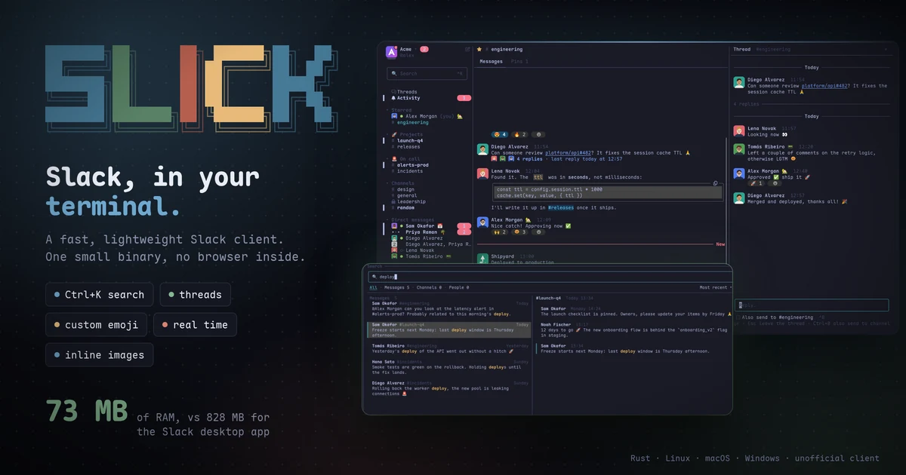
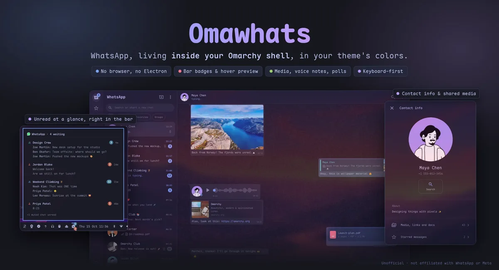
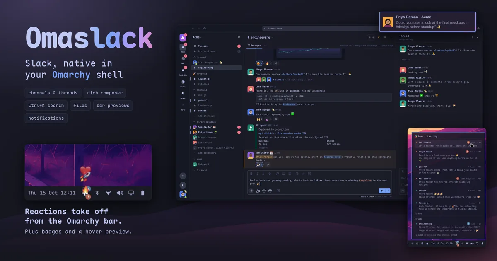
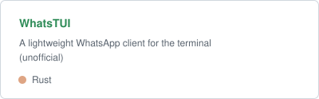

  

  Hello, my name is Leonavas and I am Head of Engineering at Febrafar, where I lead multiple teams and am technically responsible for all of Febrafar's products.

  
  

  

  If you live in the terminal and use Slack every day, as I do, try <b><a href="https://github.com/leonavas/slick">slick</a></b>: an ultrafast Slack client for the terminal, one small Rust binary. <a href="https://slick.leonavas.com">Watch the trailer</a>.

  Some plugins for people who love Omarchy:

 

  

  If you use WhatsApp on a daily basis, as I do, and use Omarchy, try out this beautiful version: <b><a href="https://github.com/leonavas/omawhats">Omawhats</a></b>

 

  

  If you use Slack on a daily basis for professional work, as I do, and use Omarchy, try out this beautiful version: <b><a href="https://github.com/leonavas/omaslack">Omaslack</a></b>

<h3 align="center" style="font-size: 18px; margin-top: 30px;">TUI Apps</h3>

  

<h3 align="center" style="font-size: 18px; margin-top: 30px;">Omarchy Plugins &amp; Themes</h3>

<table align="center">
  <tr><td><a href="https://github.com/leonavas/omarchy-slack"><b>slack</b></a></td><td>Slack in the bar: badges, hover preview and reactions</td></tr>
  <tr><td><a href="https://github.com/leonavas/omarchy-whatsapp"><b>whatsapp</b></a></td><td>WhatsApp as a tray icon with an unread dot</td></tr>
  <tr><td><a href="https://github.com/leonavas/omarchy-whatsapp-tui"><b>whatsapp-tui</b></a></td><td>Bar widget for WhatsTUI</td></tr>
  <tr><td><a href="https://github.com/leonavas/omarchy-calendar"><b>calendar</b></a></td><td>Google Calendar in the bar, with a day/week popup</td></tr>
  <tr><td><a href="https://github.com/leonavas/omarchy-dock"><b>dock</b></a></td><td>Open windows as icons, in on-screen order</td></tr>
  <tr><td><a href="https://github.com/leonavas/omarchy-mouse"><b>mouse</b></a></td><td>Mouse battery and pointer sensitivity</td></tr>
  <tr><td><a href="https://github.com/leonavas/omarchy-astroa50"><b>astroa50</b></a></td><td>Astro A50 battery, EQ, mic and mix</td></tr>
  <tr><td><a href="https://github.com/leonavas/omarchy-superstrike"><b>superstrike</b></a></td><td>Logitech PRO X 2 SUPERSTRIKE settings, no G HUB</td></tr>
  <tr><td><a href="https://github.com/leonavas/omarchy-shire-night-theme"><b>Shire Night</b></a></td><td>Theme · Loam, lamplight and pipeweed</td></tr>
  <tr><td><a href="https://github.com/leonavas/omarchy-shire-light-theme"><b>Shire Light</b></a></td><td>Theme · Shire Night, one soft step lighter</td></tr>
</table>

  

    Crafted with ☕
  

